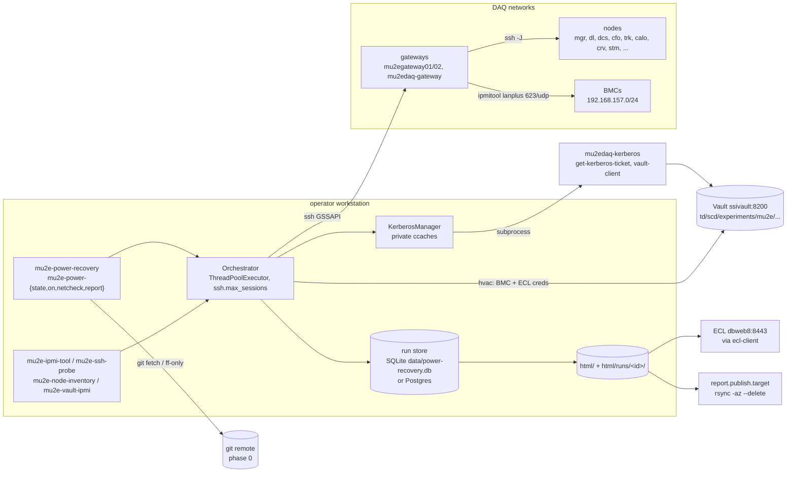

# mu2edaq-power-recovery

> Four-phase recovery of the Mu2e DAQ clusters after a power outage, driven from an off-site workstation - read-only assessment, dependency-ordered IPMI power-on run through the gateways, inter-node network mesh check, and a static HTML report optionally posted to the ECL

| | |
|---|---|
| Repository | `Mu2e/mu2edaq-power-recovery` (public, issues enabled) |
| Language | Python ≥ 3.9 (PyYAML, Jinja2, SQLAlchemy, hvac); optional C++17 `libmu2eprobe` with OpenMP and pybind11 |
| Version | 0.2.0 (`pyproject.toml:7`, `CMakeLists.txt:23`) |
| Ports | none bound. Outbound only: ssh 22/tcp, Vault 8200/tcp (HTTPS), ECL 8443/tcp (HTTPS), git remote; IPMI 623/udp and ICMP from the gateways |
| Depends on | `mu2edaq-kerberos` (subprocess, optional); data lineage from `mu2edaq-operations` (no runtime call) |
| Size | 15.2 kLOC Python source, 9.7 kLOC tests (799), 0.9 kLOC C++, 0.9 kLOC templates |

**Revision reviewed.** This page describes `origin/main` at `dc91bb2`
(v0.2.0, merged 2026-10-06 19:19 UTC, PRs #26-#33). The
`mu2e-sept-mega-review` branch this file is committed on sits at `8f1746f`,
29 commits behind it; 107 files differ, including every man page. All
`file:line` citations below are against `dc91bb2`. Rebase or fast-forward the
branch onto `origin/main` before these docs are published.

The package already carries thorough design documentation. This page is the
map, plus the cross-package view the suite needs. For mechanism and rationale
follow the links into [DESIGN.md](DESIGN.md); for the outage runbook,
[OPERATIONS.md](OPERATIONS.md); for every option, the man pages under
`man/`.

## Purpose

After a planned or unplanned outage, bring MC-2 and the HEERC teststand back
in a known order and leave a record of what was found and done. MC-1 is a
configured location with an empty inventory (#25). The tools run on the
operator's workstation, **outside** the DAQ networks. Nodes are reached with
ssh and Kerberos through the gateways. BMCs are reached by running `ipmitool`
**on** a gateway, because the IPMI subnets do not route off site
([DESIGN.md §2](DESIGN.md#2-execution-model)).

## Architecture

## Components

| Component | Role | Where |
|---|---|---|
| Driver and four single-phase entry points | argument parsing, live-run authorisation, run lock, phase 0, scope plan, phase loop, report | `cli.py:106`, `cli.py:282`, `cli.py:705` |
| Settings | defaults < YAML < `config/.env` < `MU2E_POWER_RECOVERY_*` < CLI; `redacted()` for the report | `settings.py:401` |
| Topology | NodeRange expansion, roles, `protected:`, `--validate` | `topology.py:237`, `:360`, `:450` |
| Orchestrator | credentials, per-location IPMI clients and breakers, check execution | `orchestrator.py:299`, `:398`, `:467`, `:617` |
| Credentials | Kerberos chain and private caches; mu2edaq-kerberos adapter; Vault | `creds/kerberos.py`, `creds/ticketsource.py:165`, `creds/vault.py:69`, `creds/bootstrap.py:53` |
| Transports | local subprocess, ssh with credential chain, IPMI-on-gateway, scripted fake | `transport/local.py`, `transport/ssh.py:132`, `transport/ipmi.py:238`, `transport/fake.py` |
| Checks | 25 registered checks in six modules, plus the phase-3 mesh probe (`checks/mesh.py`); profiles in `config/checks.yaml` | `checks/base.py`, `config/checks.yaml:64` |
| Phases | 1 assess, 2 power-on (`plan_sequence`, `_power_stage`), 3 mesh, 4 report | `phases/phase2_poweron.py:222`, `:418`; `phases/phase4_report.py:60` |
| Report | Jinja2 (autoescape on) static site, per-run bundles, publisher, ECL poster | `report/html.py:87`, `report/publish.py:84`, `report/ecl.py:155` |
| Phase 0 | git fast-forward, `bootstrap.sh` rebuild, re-exec | `selfupdate.py:136`, `:319` |
| Run lock | `flock`/`msvcrt` exclusive lock; `python -m mu2edaq_power_recovery.runlock` | `runlock.py`; `man 1 mu2edaq-runlock` |
| libmu2eprobe | OpenMP non-blocking TCP connect sweep; `mu2e-probe`; pybind11 `mu2eprobe` | `src/cpp/probe.cpp`, `sweep.py:98` (Python fallback) |

Threading: checks fan out on a `ThreadPoolExecutor` bounded by
`ssh.max_sessions` (16). Each check is one `ssh` subprocess. Phase 2 power
commands within a stage are serial by design. Boot waits are concurrent under
one stage deadline ([DESIGN.md §4](DESIGN.md#4-phases)). Every state-changing
IPMI call runs inside `deadline_exempt()`, so `run.phase_timeout` never
kills a power-on mid-flight (`transport/base.py:134`, `transport/ipmi.py:769-772`).

## Interfaces

External contracts are tabulated with citations in
[INTERFACES.md](INTERFACES.md): the command surface and exit codes, the
subprocess contracts with mu2edaq-kerberos and `ipmitool`, the Vault paths,
the ECL post, the run-store schema and the report data files.

## Configuration

Four YAML files in `config/`, each with a section-5 man page:
`power-recovery.yaml` (78 keys), `topology.yaml`, `power-sequence.yaml`,
`checks.yaml`. Every key can be overridden from the environment as
`MU2E_POWER_RECOVERY_<DOTTED_PATH>`. `MU2E_POWER_RECOVERY_ARM` is never
ingested as configuration and is refused in `config/.env`
(`settings.py:37-42`, `:454`). See `man 5 mu2edaq-power-recovery.yaml`.

### Topology vs power sequence (exact)

Computed with the package's own `expand_entries`/`Topology.nodes()` on
`dc91bb2`. `mu2e-node-inventory --validate` reports the same gaps.

| | `topology.yaml` | `power-sequence.yaml` |
|---|---|---|
| MC-2 nodes | 48 (37 with a BMC) | 36, in 6 stages |
| tracker | `trk` 01-18 (`:95`) | `trk` 01-14 (`:97`) |
| calorimeter | `calo` 01-14 (`:96`) | `calo` 01-11 (`:98`) |
| teststand | 17 nodes (8 BMCs) | no stage |
| MC-1 | 0 nodes | commented template |

What the sequencer does with the difference:

- **It never powers a node the topology does not know.** All 36 staged
  hosts are in the MC-2 inventory. If one were not, `Topology.resolve()`
  would give it location `unknown` and no BMC, and `_power_stage` would
  record `no_bmc` (`topology.py:466-494`, `phase2_poweron.py:470`).
- **It skips 12 MC-2 inventory nodes:** `dcs-03`, `trk-15..18`,
  `calo-12..14`, `extmon-01`, `worker-01..03`. Ten of them have BMCs. Phase 1
  reads their power state and phase 3 probes them, but phase 2 never switches
  them on. `--node mu2e-trk-15` on a power-on exits 2. CLAUDE.md records
  `trk-15..18` as a deliberate decision. The other eight are not explained
  anywhere (PWR-003).
- **It powers nothing at the teststand.** There is no teststand stage.
  `mu2e-power-on --location teststand` exits 2 with "no stage of the
  selected power sequence ... is in the requested location(s)"
  (`phase2_poweron.py:272-276`).
- **Nine of the 28 `readout` nodes have no BMC in the topology:**
  `trk-05, 06, 07, 08, 10, 13` and `calo-08, 09, 10` (`topology.yaml:111-114`
  excludes). Each is recorded `no_bmc` (`ok: False`) and counts against
  `require: majority`, which 19 of 28 still satisfies.

Against `mu2edaq-operations/scripts/nodes_config.yaml` (repo
`Mu2e/daq-operations`, last changed `2991d05`), every MC-2 and HEERC network
list is identical except one host. `mu2e-mgr-01` (lab and IPMI) is only in
power-recovery, where it is the `manager` stage that everything downstream
NFS-mounts from (PWR-004). Wave 2 counts: operations 18 trk / 14 calo,
topology 18 / 14, power-sequence 14 / 11. These agree with CONTRACT §9.7.

## Operations

There is no daemon and no service unit. An operator runs a driver,
interactively by default, or unattended with `--no-prompt` and the ARM
token. [OPERATIONS.md](OPERATIONS.md) is the runbook; `docs/INSTALL.md`
covers Linux, macOS and Windows 11. Live power needs this invocation's
authorisation (`--execute`, or `MU2E_POWER_RECOVERY_ARM` equal to
`run.label` with `run.dry_run: false`; `cli.py:282-371`). `--simulate`
contacts nothing. SIGTERM takes the Ctrl-C path, which records the
interruption and destroys the private caches (`cli.py:1014`). Phase 0
fast-forwards the checkout before every real run of phases 1-3
(`cli.py:790`). Two caveats apply: the re-exec loses the single-phase entry
point (PWR-002), and a bootstrap run leaves the checkout dirty, which switches
phase 0 off (PWR-005).

### Safety verdicts

**Protected hosts.** In phase 2 and in `mu2e-ipmi-tool`, the refusal holds
for the five spellings `chassis power off|cycle|reset|soft`:
`IPMIClient.power()` checks `protected:` before it builds the command
(`transport/ipmi.py:753-761`). Phase 2 never issues anything but `on`
(`phase2_poweron.py:480`). Protection is keyed on hostnames, exact FQDN or
short name (`topology.py:360-365`). It is independent of `roles:`, so a role
regex can neither grant nor remove it. **It is not enforced on every path.**
`mu2e-ipmi-tool` sends any other command straight to `ipmitool` with no dry-run
gate, no confirmation and no protection check (`tools/ipmi_tool.py:138-140`,
`:264`). That includes `power off`, `chassis power down`, `chassis power acpi`,
`chassis power diag`, `chassis power off now`, `chassis policy always-off` and
`raw 0x00 0x02 0x00`. With no `-n`/`-c` it targets every BMC at the location
(PWR-001, S1). There is also a second-line gap: `power()` checks
`node_host or bmc_host`, and a BMC name never matches `protected:`
(`transport/ipmi.py:754-755`). Every current caller passes `node_host`.
`mu2e-ssh-probe --root --run <cmd>` is an unrestricted remote shell; `protected:`
was never meant to cover it.

**Dry run.** It is a real gate for the drivers. For `mu2e-ipmi-tool` it gates
the same five spellings only (PWR-001).

**Secrets.** No path was found by which the BMC password, the Vault token or
the ECL key reaches the HTML report, the run store or the ECL post. The BMC
password goes over stdin into `IPMI_PASSWORD` for `ipmitool -E`
(`transport/ipmi.py:480-497`). `CommandResult.command` is overwritten with a
password-free form (`:505`), and `describe()` carries no secret. The run
row stores `settings.redacted()` (`settings.py:384-395`, `cli.py:907`). ECL
credentials are read only at post time (`report/ecl.py:167`). `-N`/`-R` are
not passed by default: `ipmi.message_timeout` and `ipmi.tool_retries` are
null (`config/power-recovery.yaml:132-133`, `transport/ipmi.py:333-336`).
The invocation is `-I lanplus -U <vault user> -L Operator -C 3 -E`.

**ssh host keys.** `StrictHostKeyChecking=accept-new` (trust on first use) is
set, never `no` (`config/power-recovery.yaml:94`). A changed key is classified
`hostkey`, stops the credential chain at once, and is reported as a probable
reimage (`transport/ssh.py:99-129`, `:327`). Command-line `-o` options do not
reach the `-J` hop, so the jump connection runs on the operator's
`ssh_config` (PWR-010).

**`~/.ipmipasswd`.** It is read with no mode or owner check, and the fallback
is taken on any Vault error, not only an outage (PWR-007).

**Phase 0.** It runs `git fetch <selfupdate.remote> <branch>` and
`git merge --ff-only`. It refuses a dirty tree, a diverged branch or a
detached HEAD. If a build input changed, it runs `bootstrap.sh`
(`pip install -e .[dev]` against `>=` bounds) and then `os.execve`. Nothing is
signature-verified (PWR-006).

## Interactions with other packages

| Package | Mechanism | Direction | Evidence |
|---|---|---|---|
| `mu2edaq-kerberos` | subprocess: `vault-client identities [args]`, `get-kerberos-ticket <identity> --cache <path> [args]`. Lookup order: configured path, then `PATH`, then `../mu2edaq-kerberos/venv/bin`, then its `src/.../get-kerberos-ticket.sh`. Optional extra `keytabs`. `kerberos.vault_client_args` is empty by default, so `--org` is not pinned (PWR-012) | out | `creds/ticketsource.py:37-43`, `:176-195`, `:306-308`, `:384`; `config/power-recovery.yaml:212-217` |
| `mu2edaq-operations` (repo `Mu2e/daq-operations`) | **data lineage only, no runtime call.** `topology.yaml` copies `scripts/nodes_config.yaml` syntax and lists. The `ipmitool` form copies `scripts/mu2e_ipmi.sh` with `-E` in place of `-P` and without `-e^`. `protected:` extends that script's exclude list. Disk thresholds come from `scripts/check_functions.sh`. `~/.ipmipasswd` is that script's convention | in (copied) | `config/topology.yaml:4-7`, `:30`; `transport/ipmi.py:301-338`; `checks/disks.py:4`; `config/checks.yaml:10`; `creds/vault.py:17-18` |
| `ecl-client` (`normanajn/ecl-client`, not in the superproject) | Python import, optional extra `ecl` | out | `report/ecl.py:159-187` |
| `mu2edaq-discovery` | not used: the package neither announces nor scans, so CONTRACT §9.5 does not apply | — | — |

The shared Vault tree `td/scd/experiments/mu2e/` is the coupling with
mu2edaq-kerberos. This package reads `ipmi/config` and `ecl`;
mu2edaq-kerberos owns `kerberos/<identity>` keytabs and is the only one that
touches them.

## Review findings

Fourteen findings are staged in [ISSUES-PENDING.md](ISSUES-PENDING.md): one
S1, one S2, nine S3, three S4. None duplicates an existing issue: #1-#24 were
closed by v0.2.0, and #25 (MC-1 inventory) is related to PWR-003 but distinct.

| ID | Sev | Title |
|---|---|---|
| PWR-001 | S1 | destructive ipmitool commands not spelled `chassis power off\|cycle\|reset\|soft` bypass `--execute`, confirmation and the protected-host refusal |
| PWR-002 | S2 | the phase-0 re-exec drops the entry point: `mu2e-power-on --execute` restarts as `--phase assess` |
| PWR-003 | S3 | power-sequence.yaml never powers 12 of the 48 MC-2 inventory nodes or any teststand node |
| PWR-004 | S3 | `mu2e-mgr-01` is the phase-2 NFS stage here but absent from the authoritative `nodes_config.yaml` |
| PWR-005 | S3 | `bootstrap.sh` rewrites the tracked `requirements.txt`, dirtying the checkout and switching off phase 0 |
| PWR-006 | S3 | phase 0 runs unverified remote code and unpinned dependencies at the start of every live run |
| PWR-007 | S3 | the `~/.ipmipasswd` fallback has no permission check and is taken on any Vault error |
| PWR-008 | S3 | `mu2e-ipmi-tool` ignores `ipmi.username` |
| PWR-009 | S3 | `rsync --delete` runs against an unvalidated `report.publish.target` |
| PWR-010 | S3 | `ssh.options` do not reach the `-J` hop; delegation forwards root-capable tickets to every node |
| PWR-011 | S3 | 799 pytest tests and a CTest suite with no CI workflow |
| PWR-012 | S4 | the mu2edaq-kerberos organisation is not pinned |
| PWR-013 | S4 | teststand IPMI subnet still given as 192.168.150.0/24 in five places |
| PWR-014 | S4 | `.TH` manual title is not the suite's `Mu2e DAQ Manual` |
